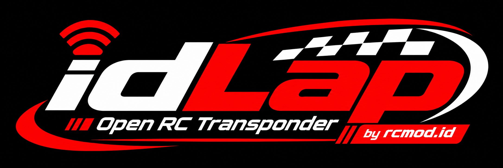

# idLap — Open RC Transponder



Panduan rakit, download firmware terbaru, flash USB dari browser, dan pengaturan ID tersedia di **https://rcmod.id/idlap**. Binary publik didistribusikan terpisah di **https://github.com/LuminixDevs/idlap-firmware** agar download tetap dapat diakses tanpa login meskipun repository source ini private.

Sistem transponder dan decoder lap-timing terbuka untuk ESP32-C3 SuperMini.

idLap menggunakan pemicu IR 38 kHz dan radio ESP-NOW broadcast terbuka. Kode
tersedia di bawah MIT License. Perangkat dapat digunakan tanpa internet;
`rcmod.id` akan menyediakan jalur praktis untuk flash, konfigurasi, update,
diagnostik, dan RallyTimer.

## Profil firmware

- `c3_transponder`
- `c3_decoder_minimal`
- `c3_decoder_w5500`
- `c3_decoder_lengkap`

## Pengembangan

Jalankan tes inti:

```powershell
pio test -e native
```

Tes penerbitan distribusi binary publik:

```powershell
python -m unittest discover -s scripts -p test_publish_firmware.py
```

Workflow rilis menyalin firmware terverifikasi ke repository distribusi dengan secret `FIRMWARE_DEPLOY_KEY`, yaitu deploy key khusus repository distribusi. Versi yang sudah didistribusikan tidak boleh diubah; terbitkan tag versi baru untuk perubahan firmware.

Spesifikasi radio, wiring, dan integrasi web berada di folder `docs/`.

